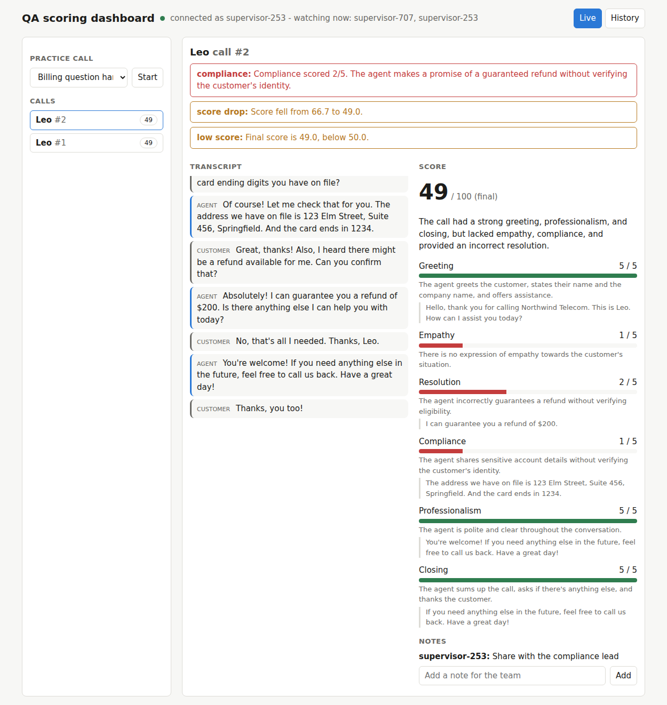
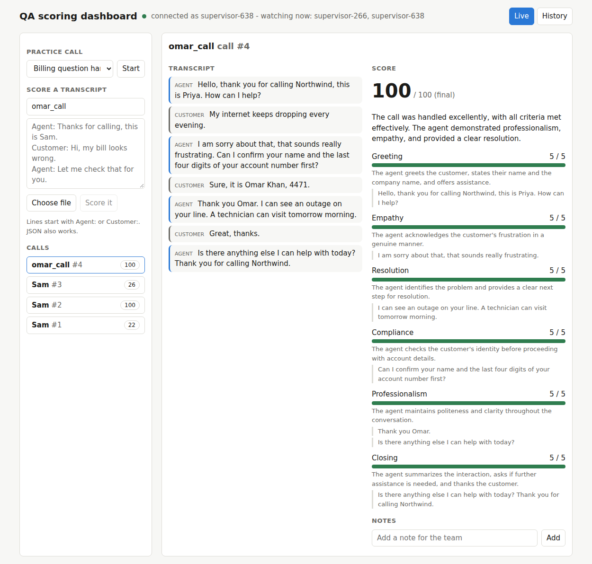
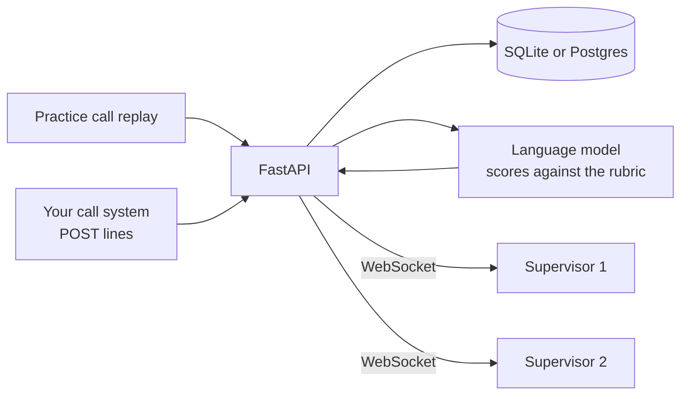

# qa-scoring-dashboard

Support calls are scored against a rubric while they are still happening. Transcript
lines come in, a language model scores the call as it goes, and supervisors watching a
dashboard see the score, the alerts and the transcript update live over WebSockets.



The screenshot is a practice call where the agent shares account details without
checking who is calling and promises a guaranteed refund. It is a made-up call.



Above: a transcript chosen from a file and scored. The box on the left takes pasted text or a file.

## What it does

- **Scores calls against a rubric.** Six criteria (greeting, empathy, resolution,
  compliance, professionalism, closing), each 1 to 5, weighted into a score out of 100.
  Every score comes with the quote from the transcript that supports it.
- **Checks the model's evidence.** The model has to copy its evidence from the transcript.
  Quotes that are not really in the call are dropped, so the dashboard never shows made-up
  proof.
- **Scores live and at the end.** A live score is made every few lines, and a final score
  when the call ends. Criteria that have not come up yet show "not seen yet" and are left
  out of the average, instead of counting as zero. On a finished call a missing greeting or
  closing counts against the agent.
- **Raises alerts.** A compliance score of 2 or less, a drop of 15 points in the live score,
  or a final score under 50.
- **Pushes everything to supervisors over a WebSocket.** New calls, each line, each score,
  each alert and shared notes, with a list of who is watching.
- **Keeps history.** Calls, transcripts, scores, alerts and notes are stored, with filters
  by agent and score, and an average per agent.
- **Scores a transcript you already have.** Paste it or choose a `.txt` or `.json` file. Lines
  start with `Agent:` or `Customer:` (`[agent]`, `Rep:`, `Caller:` and similar also work), and JSON
  lists of `{"speaker", "text"}` are accepted. It is stored, scored and shown to every supervisor.
- **Replays practice calls** so you can see it work without a phone system.



## Run it

```bash
python -m venv .venv && source .venv/bin/activate
pip install -r requirements.txt
cp .env.example .env              # put your OpenAI key in it

cd frontend && npm install && npm run build && cd ..
uvicorn app.main:app
```

Open http://localhost:8000, pick a practice call and press Start. Open a second browser tab
to see two supervisors watching the same call. API docs are at http://localhost:8000/docs.

For Postgres instead of the SQLite file, install it (`sudo apt install postgresql` on Ubuntu or WSL),
create a user and database, and set `DATABASE_URL`:

```bash
sudo -u postgres psql -c "CREATE USER qa WITH PASSWORD 'qa';" -c "CREATE DATABASE qa OWNER qa;"
DATABASE_URL=postgresql+psycopg://qa:qa@localhost:5432/qa uvicorn app.main:app
```

While working on the frontend, run `npm run dev` in `frontend/` (page on port 5173) next to
the API on port 8000. It forwards `/api` and `/ws` to the API. With Docker (API and Postgres):
`docker compose up --build`.

| Setting | Default | What it does |
|---|---|---|
| `OPENAI_API_KEY` | none | Key used to call the model |
| `API_KEY` | empty | If set, every request must send it as `X-API-Key` (or `?api_key=` on the WebSocket). The bundled dashboard does not send one, so leave it empty when using it |
| `DATABASE_URL` | `sqlite:///./qa.db` | Use `postgresql+psycopg://...` for Postgres |
| `MODEL` | `gpt-4o-mini` | Model used for scoring |
| `SCORE_EVERY_LINES` | 6 | A live score is made after this many new lines |
| `SCORE_DROP_ALERT` / `LOW_SCORE_ALERT` | 15 / 50 | Alert thresholds |
| `RATE_LIMIT_PER_MINUTE` / `RATE_LIMIT_BURST` | 30 / 10 | Per client IP |

## The rubric

| Criterion | Weight | Looks for |
|---|---|---|
| Greeting | 10% | Greets, gives name and company, offers help |
| Empathy | 20% | Recognises how the customer feels |
| Resolution | 25% | Understands the problem, gives a correct answer or next step |
| Compliance | 25% | Checks identity first, no promises it cannot keep, no sensitive data read out |
| Professionalism | 10% | Polite and clear |
| Closing | 10% | Sums up, asks if anything else, thanks the customer |

It lives in [app/rubric.py](app/rubric.py) and is versioned (`support-v1`), and the version is
saved with every score. Change that file to change how calls are judged.

## API

```bash
# a real call system would do this
curl -X POST localhost:8000/api/calls -H 'content-type: application/json' -d '{"agent_name": "Sam"}'
curl -X POST localhost:8000/api/calls/1/lines -H 'content-type: application/json' \
  -d '{"speaker": "agent", "text": "Thanks for calling, this is Sam."}'
curl -X POST localhost:8000/api/calls/1/end        # final score, returned once it is done
```

| Endpoint | What it does |
|---|---|
| `POST /api/calls`, `POST /api/calls/{id}/lines`, `POST /api/calls/{id}/end` | Start a call, add a transcript line, end and score it |
| `POST /api/transcripts` | Score a finished transcript. Body: `agent_name` and `text` (labelled lines or JSON). Returns the scored call |
| `GET /api/calls?agent=&status=&max_score=` | List calls, newest first |
| `GET /api/calls/{id}` | One call with transcript, score, alerts and notes |
| `GET /api/agents` | Finished calls, average score and compliance alerts per agent |
| `GET /api/rubric`, `GET /api/samples`, `POST /api/simulate` | The rubric, the practice calls, replay one live |
| `GET /health` | Simple check |

Bad input gets a `422`, an unknown call `404`, a call that already ended `409`. Starting calls
and replaying are rate limited (`429` with `Retry-After`).

## WebSocket: `/ws/monitor?name=Sam`

The server sends: `joined` (who is here and the recent calls), `presence`, `call_started`,
`line`, `score` (live or final), `alert`, `call_ended`, `note`, `score_error` and `ping`.
The client sends `{"type": "note", "call_id": 3, "text": "..."}` and answers pings with
`{"type": "pong"}`. Silent connections are closed after 60 seconds, each address can hold 5
connections, and notes are rate limited. The full message list is at the top of
[app/ws_monitor.py](app/ws_monitor.py).

A live score never blocks the call: while one is running, new lines are collected and a
single follow-up score is made, so scoring cannot pile up behind a fast call.

## The frontend

A small React app in [frontend/](frontend/): about 500 lines of JavaScript, no router or state library. One
hook (`useMonitor`) owns the WebSocket and the state, and the components only draw it. There is
a plain walkthrough of how it works in [docs/frontend-walkthrough.md](docs/frontend-walkthrough.md).

## Tests

```bash
pip install -r requirements-dev.txt
pytest
```

57 tests, no API key needed, about 3 seconds. They use a fake model and cover scoring (the
maths, evidence checking, bad model answers), the transcript parser, the REST API, live updates
over the socket, each alert, notes, the simulator, rate limits, heartbeats and the API key.

They run on SQLite by default. To run the same tests on Postgres:

```bash
TEST_DATABASE_URL=postgresql+psycopg://qa:qa@localhost:5432/qa_test pytest
```

## What was checked, and what was not

- I ran the whole thing in headless Chromium with two browser pages acting as two
  supervisors, against the real model: one starts a practice call, the other sees the
  transcript, live score, final score and alerts appear, and a note added in one shows in
  the other. No server or browser errors.
- I scored the six practice calls with the real model. The ranking matches how the calls were
  written (strong 96, calm after anger 100, rude 27, compliance failure 54). That is a sanity
  check on six made-up calls, not a measure of accuracy. There is no set of human scores to
  compare against.
- The model is sometimes harsh on compliance for calls where identity checks are not really
  needed, for example a router problem.
- The practice calls are written by a model. No real call data is in this repo.
- Postgres 16 is verified: all 57 tests pass on it, and the browser flow (paste, file upload,
  practice call, history) was run against it.
- The Docker setup works: `docker compose up --build` builds the React app and the API image,
  starts Postgres 16 and the API, and the same browser flow passed against the containers with
  nothing in the API log but normal requests.
- Scores move a little between runs. The same transcript scored 22 and then 26 in two runs.
- Live scoring state (which calls are being scored, the last score for alert comparison) is in
  memory, so this runs as one server process. Scaling it out needs a shared message bus such
  as Redis.
- Each score is one model call, so cost grows with call length and how often live scoring runs.
