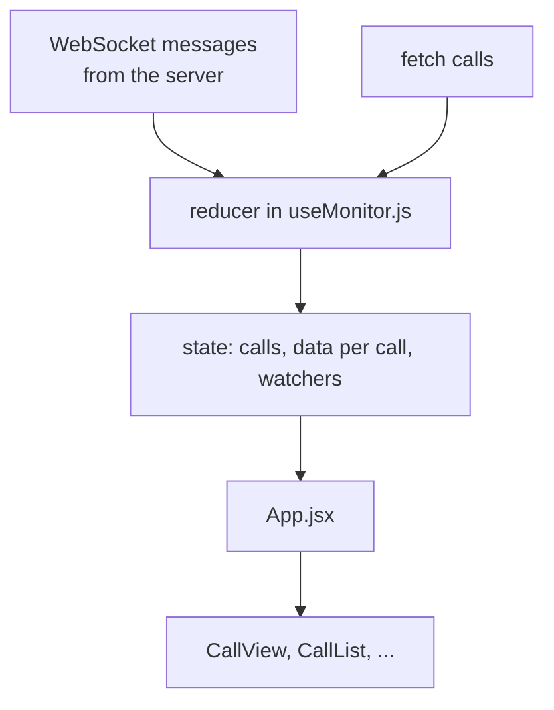

# How the frontend works

A short guide to the React code in `frontend/src`, written so you can explain every part.

## The idea

The page does two things:

1. It **asks** the API for things (the list of practice calls, one call's details, history).
2. It **listens** on a WebSocket for things the server pushes (new calls, new lines, scores,
   alerts, notes), and redraws when they arrive.

Everything else is drawing that data.

## The files

| File | Job |
|---|---|
| `main.jsx` | Starts React and draws `<App />` into the page |
| `App.jsx` | The screen: header, left column, main area, and which tab is open |
| `useMonitor.js` | The WebSocket and all the data. The most important file |
| `api.js` | Small functions that call the REST API with `fetch` |
| `components/CallList.jsx` | The list of calls on the left |
| `components/ImportTranscript.jsx` | The box for pasting or choosing a transcript file and scoring it |
| `components/CallView.jsx` | One call: alerts, transcript, score, notes |
| `components/ScorePanel.jsx` | The big number and the bar for each criterion |
| `components/Notes.jsx` | Shared notes and the box to add one |
| `components/History.jsx` | The history tab: agents table and filtered calls table |
| `styles.css` | All the styling, with a light and a dark theme |

## How the data flows

Each message from the server has a `type` (`line`, `score`, `alert`, ...). The **reducer** is one
function in `useMonitor.js` with a `case` for each type. It takes the current state and a message
and returns the new state. React sees the new state and redraws whatever changed.

## The React ideas used

- **Components** are functions that return what to draw (`CallList`, `ScorePanel`, ...).
- **Props** are how a parent passes data to a child, like `<CallList calls={...} onSelect={...} />`.
- **`useState`** keeps a value that, when it changes, redraws the component (the selected call,
  the chosen practice call, the open tab).
- **`useEffect`** runs code at a certain moment. In `useMonitor` it opens the WebSocket when the
  page loads and closes it when the page goes away. In `CallView` it scrolls the transcript down
  when a new line arrives.
- **`useReducer`** is like `useState` for state with many kinds of updates. It fits here because
  there are many message types, all changing one shared state.
- **`key`** on list items (`key={line.seq}`) lets React tell items apart so it only redraws
  the ones that changed.

## Details worth knowing

- **Reconnecting.** If the socket closes, `ws.onclose` waits 2 seconds and connects again.
- **Heartbeat.** The server sends `ping` every 20 seconds, and the hook answers `pong`. Without
  that the server would close the connection after 60 quiet seconds.
- **Joining a call that is already running.** The socket only sends what happens from now on. So
  when you click a call, `loadCall` fetches its full details once and merges them with what has
  arrived. Lines carry a number (`seq`), so `addLines` can skip any line it already has.
- **Live and final scores.** A live score can arrive just after the final one. `betterScore` makes
  sure a final score is never replaced by a live one.
- **Choosing a file.** The browser reads the file itself (`file.text()`) and puts the text in the box,
  so you can look at it before pressing Score. Only the text is sent to the API, as JSON.
- **Notes.** Sent over the WebSocket. The server saves each note and sends it to every
  supervisor, including the sender, so everybody sees the same list.
- **Dev proxy.** `vite.config.js` forwards `/api` and `/ws` to the API on port 8000 so the page
  and the API look like one site in development. In production FastAPI serves the built page
  itself, so no proxy is needed.

## Questions you may get

**Why a WebSocket and not polling?** Scores and lines arrive at unpredictable times. Polling would
either be slow or send lots of useless requests. A WebSocket lets the server push the moment
something happens, and it can push to all supervisors at once.

**Why a reducer?** All the messages change one connected set of data. A reducer keeps every change
in one place that is easy to read and to test, instead of many `useState` calls spread around.

**Why no Redux or router?** There is one page and one shared state. Adding more would be extra code
for no benefit here.

**What would you add next?** Tests for the reducer, TypeScript, a way to pick or log in as a
supervisor, and showing which supervisor has each call open.
